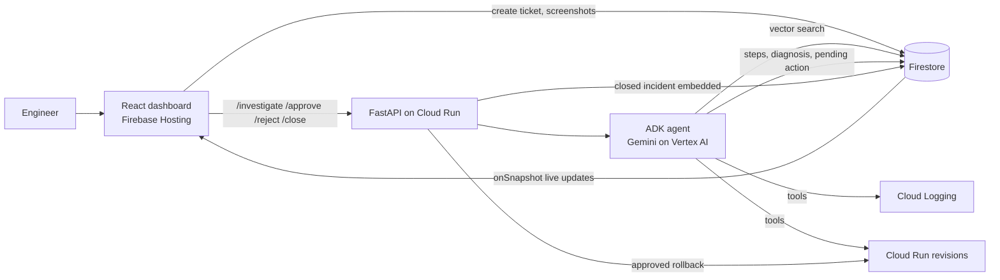

# Architecture (for the deck)

Key point: the agent can only propose an action. Rollback runs in the approval endpoint, so human approval is enforced in code.

## Priority 1 Python backend

`backend/main.py` exposes FastAPI routes. `backend/agent.py` runs a Google ADK agent with Vertex AI Gemini; `backend/tools.py` defines read-only investigation tools plus `propose_action` and `submit_diagnosis`. The agent does not receive a rollback or traffic mutation tool. `backend/retrieval.py` uses Firestore vector search when project credentials and indexes are configured, with a labelled lexical fallback over the checked-in JSON corpus. `backend/store.py` persists incident state and ordered steps in Firestore, or uses an in-memory adapter for local smoke tests.

The local fallback is not live incident response: it cannot inspect production logs, revisions, or health. `/approve` records a decision but does not execute rollback until Priority 2 is implemented.
